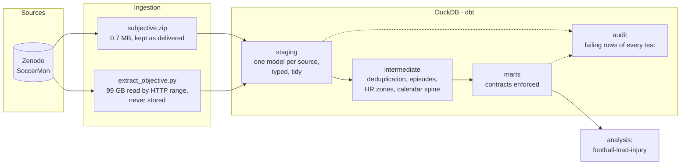

# athlete-data-governance

[](https://github.com/Clement0242/athlete-data-governance/actions/workflows/dbt.yml)

**A governed warehouse for athlete monitoring data**: questionnaires (RPE,
wellness), injuries, GNSS and heart rate. It is built with dbt and DuckDB on
**SoccerMon**, the open dataset of two elite women's football teams (2020–2021).

Most sport-science pipelines are a folder of scripts that each recompute their
own "daily load". The aim here is the opposite: **one documented definition of
each indicator, tested on every run, with the defects of the source written
down rather than silently patched.**

🌐 **Project page (dictionary, lineage, quality):** https://clement0242.github.io/athlete-data-governance/
✅ **Quality report:** [`docs/quality.md`](docs/quality.md)

*Version française plus bas.*

## Architecture



| Layer | Rule |
|---|---|
| `staging` | One model per source table. Renaming, typing and reshaping only: wide → long, JSON → rows. No business rule. |
| `intermediate` | Business rules, each in one place: what a duplicate is, what an injury episode is, how HR zones are computed. |
| `marts` | The only layer anyone reads. Every column is documented with a unit and a sensitivity level, and the contracts (names and types) are enforced: a change that breaks a consumer fails the build. |
| `audit` | Failing rows of every test, stored as tables (`store_failures`): a warning can be inspected, not just counted. |

## The marts

| Mart | Grain | Content |
|---|---|---|
| `dim_player` | player | Period covered and what each source holds; estimated HRmax |
| `fct_training_session` | session | RPE, duration, sRPE (Foster), incomplete-report flag |
| `fct_gps_session` | player × day | Distance by speed zone, accelerations, accelerometer load, Edwards TRIMP, **heart rate at 2.5 m/s**, TRIMP per km |
| `fct_injury_episode` | episode | Injury episodes rebuilt from daily reports (body location, region, side, severity, span) |
| `fct_player_day` | player × day | Every source aligned on a calendar spine; null = not reported, never zero |
| `mart_source_coverage` | player × month | Share of days each source reported |

## What the quality rules found

The rules run on every build (`dbt build`: 128 nodes, 108 rules). Five of them
are warnings: each documents a real defect of the published dataset, and the
quarantine flags catch two more.

* **Heart rate frozen at 82 bpm.** 2,863 of the 10,075 recordings show one
  value for most of the session, the strap's default. It would pass every range
  check; the share of time spent at a single value catches it. Only 1,323
  recordings have a usable heart rate.
* **The provider's daily load does not match its own session reports** for 3
  players on 110 days. It is always higher, never lower (median +420 AU), so
  sessions are missing from the export. The warehouse recomputes the load from
  the sessions it actually has.
* **Players pseudonymised twice.** 28 players have GNSS data but no
  questionnaire, under another UUID format. A linkage on attendance was tried
  and cannot tell teammates apart, so no link is guessed.
* **Two different recordings under one file name** (81 names, 2 players,
  2021): nothing says which is the player's, so both are quarantined.
* **An empty player column** in 3 files whose name carries the identifier: it
  is recovered from the name by a visible rule.
* **Injury reports submitted twice** on the same day (harmless, documented).

Other choices are written as rules rather than buried in code:

* **76 exact repeat sessions** (same player, day, RPE and duration) are
  flagged in staging and removed in one intermediate model.
* The provider's ACWR is checked to be **ATL / CTL28** with rolling means,
  i.e. the "coupled" ratio criticised by Lolli et al. (2019). The warehouse
  does not publish an ACWR at all and leaves the choice to the analysis.
* **A day without a report is null, not zero.** The provider's daily-load
  files use 0 for "no session" *and* for "no report"; `fct_player_day` keeps
  the difference through `has_rpe`, `has_gps` and `has_wellness`.

## Personal data

Health data is a special category under GDPR (art. 9). Even pseudonymised, it
is treated as such:

* The players are pseudonymised by the provider, and no other identifier
  enters the warehouse.
* Every mart column carries `meta.sensitivity`: `operational`,
  `pseudonymised identifier` or `health`. A BI tool or an access policy can
  read that tag to decide who sees what (for example, the medical staff sees
  `fct_injury_episode`, a coach sees availability only).
* The raw 100 Hz files are never stored; only the features needed downstream are.

## Run it

```bash
pip install -r requirements.txt
export DBT_PROFILES_DIR=.
./publish.sh    # dbt build (models, 100+ rules, contracts), quality report,
                # dbt docs, project page (docs/), published marts (data/marts/)
```

The subjective data and the extracted objective features are committed
(`data/`), so the build runs as is, in CI included. To re-extract the objective
features from Zenodo (about 1.5 h, ~99 GB streamed):
`python ingest/extract_objective.py --workers 28`.

## Data

SoccerMon: Midoglu C. et al. (2024). *A large-scale multivariate soccer athlete
health, performance, and position monitoring dataset.* Scientific Data 11, 553.
Zenodo record 10033832, licence **CC-BY 4.0**. The derived files in `data/derived`
are a transformation of that dataset under the same licence. Code: MIT.

---

## En français

Un **entrepôt de données athlètes gouverné**, construit avec dbt et DuckDB sur
SoccerMon (deux équipes féminines élite, 2020–2021) : questionnaires RPE et
wellness, blessures, GPS et fréquence cardiaque.

* **Couches** : staging (typage, mise en forme), intermediate (chaque règle
  métier à un seul endroit), marts (contrats de données imposés). Une couche
  d'audit conserve les lignes en échec de chaque test.
* **Dictionnaire de données** : chaque colonne publiée a une description, une
  unité et un niveau de sensibilité (données de santé, RGPD art. 9). Le site de
  documentation montre aussi le lignage.
* **108 règles qualité** exécutées à chaque build. Elles ont trouvé de vrais
  défauts dans le jeu de données publié :
  * une fréquence cardiaque figée à 82 bpm dans 2 863 enregistrements ;
  * une charge quotidienne fournie qui ne correspond pas aux séances exportées
    (3 joueuses, 110 jours) ;
  * 28 joueuses pseudonymisées deux fois ;
  * des fichiers en double portant le même nom ;
  * 76 séances en double.
* **Rien n'est supprimé :** chaque enregistrement porte un indicateur de
  qualité, et les indicateurs ne sont calculés que sur les données valides.
* **Un jour sans données reste vide, jamais zéro.**

Auteur : [Clément Verdier](https://clement0242.github.io), ingénieur data et
sport scientist.
